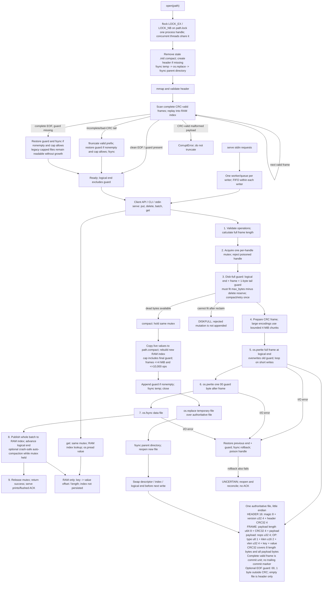

# Architecture

## Part 1: Current architecture diagram

## Part 2 Proof table
| ID | Scenario | Disk state at the kill | Mechanism | Where in code (file:function) | Verified by |
|---|---|---|---|---|---|
| A1 | Kill before any bytes of a put reach the file → key absent or previous value | `H prev G` (G = the 1-byte `00` EOF guard); the new frame exists only in process memory | Nothing reached the file, so recovery replays exactly the previous frames. The key keeps its previous value or stays absent. No ACK was sent (ACK only after return). | engine.py:`_write` (`before_write`, 207); engine.py:`_scan` | `tests.test_engine.CrashPointTest.test_before_write`; `tests.test_crash_campaign.test_all_write_points_for_put_delete_batch_large_value_and_large_batch`; crashpoints 9001 (`before_write:1`, `before_write:3`) |
| A2 | Kill after some bytes of the record are written (torn write) → key absent or previous value; torn bytes never returned | `H prev` + the first 1..len-1 bytes of the new frame, written over the old guard | `decode_frame` returns `None` when fewer than 12 bytes remain (format.py:112) or the payload is short (format.py:118). `_recover` then runs `ftruncate(stop)`, rewrites the guard (`_restore_tail_guard`) and `fsync`s. (A 1-byte prefix equal to `00` is indistinguishable from the guard and is kept as one, which changes nothing.) Values are served only from the index, which never referenced the torn bytes, so they cannot be returned. | format.py:`decode_frame`; engine.py:`_recover` (139-143) | `test_engine.CrashPointTest.test_torn_write`; `test_crash_campaign.test_every_byte_of_final_frame_and_short_header` (every cut point); crashpoints 9001 (`torn_write:1`, `:2`); default 9007 / 7001 / 7002 / 9500 (forced torn_write every 5th round) |
| A3 | Kill after the record is fully written but before fsync → either outcome (not acknowledged); nothing else corrupted | `H prev F(new)` in the page cache, not fsynced | After SIGKILL the page cache survives, so the frame is complete and CRC-valid and gets replayed. The earlier frames are untouched, because appends never rewrite older bytes. After a power cut the frame could be absent or torn, which leads to A2's path (UNCERTAIN: no power-cut test). | engine.py:`_write` (`after_write`, 213) | `test_engine.CrashPointTest.test_after_write`; campaign write-points test; crashpoints 9001 (`after_write:3`) |
| A4 | Kill after fsync returns but before put returns success → key present with new value | `H prev F(new)`, durable; index not updated | Recovery rebuilds the index from the log, so the frame is replayed regardless of the lost in-memory index. | engine.py:`_write` (`after_fsync`, 215); `_scan` / `_apply` | `test_engine.CrashPointTest.test_after_fsync`; campaign write-points test; crashpoints 9001 (`after_fsync:3`) |
| A5 | Kill immediately after put returns success → key present with new value | `H prev F(new)`, durable and indexed | The return happens only after `fsync` (`_commit` 191). The kill just before ACK is `after_return`. After ACK, the oracle requires the key to be present. | serve.py:`run.execute` (`after_return` before `reply("ACK")`); engine.py:`_commit` | `tests.test_torture.test_after_return_crash_keeps_value_without_ack`; crashpoints 9001 (`after_return:1`); default 9007 / 7001 / 7002 / 9500 (every ACKed op checked) |
| A6 | Kill during a delete → key present with old value, or absent; never corrupted | As A1-A5, with a frame holding one DEL op (`type=2`, `vlen=0`) | A delete is an ordinary frame through the same `_commit` / `_write`, so the same rules apply. `_apply` removes the key only when a complete DEL frame is replayed. | engine.py:`delete` → `_commit`; `_apply` | campaign write-points test, kind `delete`, all 5 write hooks; default 9007 (53 dels), 7001, 7002, 9500 |
| A7 | Kill during a put of a 1 MB value → same rules as A1-A5 | As A1-A5, with a frame of 12 + 4 + 7 + klen + 1,048,576 bytes | Same frame path. `_pwrite_all` loops until every byte is written, and a partial write is a torn tail (A2). | engine.py:`_pwrite_all`, `_write` | campaign write-points test, kind `large-value` (1 MiB value), all 5 write hooks; large-values 9005 (first op of each writer is 1 MiB) |
| B1 | Kill after 3 of 10 batch ops are written → none of the 10 visible | A prefix of the single batch frame: some ops' bytes present, the rest missing | No per-op writes exist. Any prefix of the frame fails `pos+12+len > size` (format.py:118), and `_scan` applies ops only after the whole frame decoded, so zero ops apply. A 10-op batch specifically was not used; the tests use 3-op and 10,000-op batches. | format.py:`decode_frame`; engine.py:`_scan` (146-155) | `test_crash_campaign.test_every_byte_of_final_frame_and_short_header` (every prefix of a 3-op batch frame); campaign write-points `torn_write`, kinds `batch` (3 ops) and `large-batch` (10,000); crashpoints 9001 `torn_write` on the 3-op `w2-target` batch |
| B2 | Kill after all 10 are written but the commit marker is not → none visible (our design: the frame's length+CRC is the commit) | Every payload byte present but the frame not valid: either the file is shorter than `12+len` (the last bytes are missing), or the bytes are stale or garbage and the CRC does not match | `len` + `crc` are at the frame start, but they commit only together with the full payload. A short frame fails format.py:118; a CRC mismatch fails format.py:123. Both return `None`, giving a torn tail that is truncated. | format.py:`decode_frame` (118, 123) | `tests.test_format` `test_truncated_at_every_byte`, `test_flipped_bit_in_payload`; `test_crash_campaign.test_every_byte_of_final_frame_and_short_header` (cuts inside the last op) |
| B3 | Kill after the commit marker is written but before fsync → all or none, never some | Complete batch frame in the page cache, not fsynced | SIGKILL: the complete frame is replayed, so all ops apply. Power cut: the frame is either complete or fails the length/CRC check, so all or none. A partial apply is impossible because `_scan` applies ops only from a fully decoded frame. | engine.py:`_write` (`after_write`); `_scan` | campaign write-points test, kinds `batch` and `large-batch` with `after_write`; crashpoints 9001 `after_write:3` (3-op batch, all present) |
| B4 | Kill after the batch returns success → all 10 visible | Durable, indexed batch frame | Same as A5: `batch` returns only after `fsync`, and the oracle requires every op of an ACKed batch. | engine.py:`batch` → `_commit` | campaign write-points test (`after_return`, `batch`); default 9007 (130 batches), 7001, 7002, 9500; large-batch 9006 |
| B5 | Batch that puts X and deletes X → ordering defined in README and honoured after a crash | One frame whose ops include `PUT X ... DEL X` | README: "ops apply first to last". `_commit` applies ops in order (192-194), and `_scan` applies the decoded ops in frame order, so recovery gives the same result as the live engine. | engine.py:`_commit`, `_scan`, `_apply` | `test_engine.BasicTest.test_batch_put_then_del_leaves_absent` (no crash); `tests.test_torture.test_delete_and_batch_order` (oracle). After a crash: default 9007 / 7001 / 7002 / 9500 batches reuse 32 keys per writer with 20% deletes, and the oracle applies them in order (UNCERTAIN: I did not count how many batches contained put-then-del of the same key). |
| B6 | 10,000-op batch killed halfway → none visible; recovery still under 2 s | Prefix of a ~10,000-op frame (or the complete frame, if the kill came after the write) | Same as B1. Recovery cost is one `decode_frame` over the frame. | format.py:`decode_frame`; engine.py:`_recover` | campaign write-points test, kind `large-batch` (10,000 ops), `torn_write` at a random prefix; large-batch 9006 (100% of kills with a 2-10,000-op batch in flight). Recovery time for this case was not measured separately. It is bounded by F3 (1.01M keys in 873.6 ms, `tests.bench_f3_kill --seed 31337`). |
| C1 | Kill during open() while replaying the log → next open succeeds, same correct state | Unchanged. The scan reads through `mmap(ACCESS_READ)` and writes nothing. | The index is in memory only. The next open rescans from offset 16. | engine.py:`_scan` (`recovery_mid_scan`, 149) | `test_engine.CrashPointTest.test_recovery_points`; `test_crash_campaign.test_repeated_crashes_during_recovery`; recovery-crash 9002; crashpoints 9001 (`recovery_mid_scan:3`) |
| C2 | Kill during open() while truncating/repairing a torn tail → next open succeeds | Before `ftruncate`: `H prev T`. After the repair: `H prev G`, durable. | Truncating to the same `stop` and rewriting the guard is idempotent. The next open computes the same `stop` and truncates again, or finds nothing left to truncate. | engine.py:`_recover` (`recovery_before_truncate` 140, `recovery_after_truncate` 143) | same tests as C1; recovery-crash 9002 (torn tail made by the real `torn_write` hook); crashpoints 9001 |
| C3 | Kill during compaction before the new file replaces the old → old file authoritative, all data intact | `<path>` = old file (untouched). `<path>.compact` partial (not fsynced) or complete (fsynced). | `<path>` is never written during the copy. `_open_file` removes `.compact` unread (106). | engine.py:`_copy_live` (`compact_mid_copy`, 313), `_compact_locked` (`compact_before_rename`, 275), `_open_file` | `tests.test_compact.CompactCrashPointTest.test_crash_points`; `test_crash_campaign.test_all_compaction_points_with_multiple_frames`; compaction 9003; crashpoints 9001 |
| C4 | Kill during compaction in the middle of the rename/swap → exactly one of old/new authoritative, both complete, nothing lost | Just before `os.replace`: the old file at `<path>` plus a complete `.compact`. Just after: the compacted file at `<path>`. | `os.replace` is `rename(2)`, which is atomic within one directory, so there is no in-between state. Both files are complete (the temp was fsynced before the rename). After the rename the directory fsync (282) makes the new name durable. A power cut before that can only bring back the old, complete file (UNCERTAIN: tested only with SIGKILL). | engine.py:`_compact_locked` (275-283) | compaction 9003 (`compact_before_rename`, `compact_after_rename`); `test_compact.CompactCrashPointTest.test_crash_points`; crashpoints 9001 (`compact_after_rename:2`, `:3`) |
| C5 | Kill after the swap but before temp-file cleanup → data intact; leftovers cleaned up or ignored on next open | Compacted file at `<path>`. After a successful rename there is no temp file, because the rename consumed it. | The code has no separate cleanup step after the swap. A leftover can exist only from a crash before the rename (C3), and `_open_file` deletes `.compact` and `.init` on every open. | engine.py:`_compact_locked` (`compact_after_swap`, 291); `_open_file` (106-107) | compaction 9003 (`compact_after_swap`); crashpoints 9001 (`compact_after_swap:2`, `:3`); `test_compact.CompactCrashPointTest.test_crash_points` asserts no `.compact` after reopen |
| C6 | Kill during close() → same as a kill at any other time | `H prev`, all committed frames already fsynced in their own `_write` | `close` writes nothing, so a crash there is the same as any idle crash. | engine.py:`close` (`close_mid`, 340) | `test_engine.CrashPointTest.test_close_mid`; `test_crash_campaign.test_initial_creation_and_close_crashes`; disk-full 9004; crashpoints 9001 (`close_mid:1`) |
| D1 | Two writers putting different keys, killed at random → every acknowledged put from either writer present | Interleaved frames from w1 and w2; at most one op per writer in flight | Each op is its own frame, and `self._lock` serialises `_commit`, so frames never interleave inside one another. ACK is sent per op after its own `fsync`. | engine.py:`_commit` (`self._lock`); serve.py:`dispatch` (one worker per prefix) | default 9007, 7001, 7002, 9500: the oracle requires every ACKed op of both writers |
| D2 | Two writers putting the same key, killed at random → key holds a value one writer actually wrote, never a mix | Frames from both writers for `shared/status` | A value is stored whole inside one CRC'd frame, and the index points at exactly one frame's value. Values are self-describing (`seed:iteration:op_id:item:` + filler), so the oracle can tell whose value it is and rejects values overtaken by a later completed op. | engine.py:`_apply`; torturelib/oracle.py:`worlds` | default 9007 (22 shared-key ops), 7001 (426), 7002 (546), 9500; `test_crash_campaign.test_shared_keys_final_batch_is_not_mixed` (no kill); `tests.test_review_fixes.test_shared_key_cannot_hold_overtaken_value` |
| D3 | One writer in a long batch, another doing single puts, killed at random → batch all-or-nothing; acknowledged puts present | Possibly a torn 10,000-op frame from one writer after the other writer's complete single-op frames | B1 plus D1. The single put waits for the lock (`_commit`) while the batch frame is written and fsynced. | engine.py:`_commit`; format.py:`decode_frame` | default runs, kills with a ≥256-op batch in flight from one writer and a single op in flight from the other: 9007 (5 kills), 7001 (46), 7002 (41); counted from each run's oracle.log (KILL `in_flight` × SENT op counts) |
| D4 | A reader calling get during a batch on the same keys (no crash) → sees before or after the batch, never in between | n/a (no crash) | `_commit` updates every op of a frame inside `self._lock` (179-196), and `get` / `items` take the same lock (229, 243). Note: two separate `get` calls are not a snapshot, so the guarantee is per call. | engine.py:`_commit`, `get`, `items` | **new** `tests.test_engine.BasicTest.test_reader_sees_batch_all_or_nothing` (reader loops `get` in batch order and `items()` over 299 batches of 20 keys; a planted one-frame-per-op `batch` made it fail at once); `test_crash_campaign.test_reader_cannot_observe_half_applied_batch` |
| E1 | Size cap reached during a single put → put returns an error; database readable; previous data intact | Unchanged; nothing was written | `_check_space` (198-203) runs before `_write`. If `end + frame > max_bytes - reserve`, it raises `DiskFull`, so nothing is written and serve replies `ERR <id> DISKFULL`. | engine.py:`_check_space`, `_commit` (184-190) | `test_engine.DiskFullTest.test_max_bytes`; `tests.test_serve.test_disk_full_never_acknowledges`; disk-full 9004 |
| E2 | Cap reached halfway through a batch → batch returns an error; none of its ops visible | Unchanged | The check is on the whole frame's size before any byte is written, so a batch cannot run out of space halfway. It is rejected as a unit. | engine.py:`_check_space` | `tests.test_serve.test_disk_full_batch_changes_nothing`; `test_crash_campaign.test_disk_full_rejection_delete_reserve_and_compaction`; disk-full 9004 (`w1-batch` rejected, oracle checks it is absent) |
| E3 | Cap reached, then process killed → restart succeeds; all acknowledged data intact | `H` + accepted frames up to the cap; rejected ops left no bytes | Rejections write nothing (E1), so the file is an ordinary valid log. Deletes still fit in the reserve `min(65536, max_bytes // 10)`. | engine.py:`_check_space`; `close` (`close_mid`) | disk-full 9004 (`close_mid` kill after reaching the cap at 3000 bytes); `test_crash_campaign.test_disk_full_rejection_delete_reserve_and_compaction` |
| E4 | Cap reached during compaction → compaction fails or completes; no data lost; database still opens | `<path>` = old file; `.compact` partial, then removed | `_write_compact_frame` raises `DiskFull` when the compacted file would exceed `max_bytes`. The `except BaseException` in `_compact_locked` removes the temp file and leaves the old fd, index and file untouched (277-279). | engine.py:`_write_compact_frame` (318-319), `_compact_locked` | `test_compact.CompactDiskFullTest.test_tiny_cap_during_compaction`; `test_compact.CompactTest.test_failure_before_rename_keeps_old_state` (injected `os.replace` error); `test_crash_campaign.test_disk_full_rejection_delete_reserve_and_compaction` |
| E5 | After deletes free space, compaction runs, writes succeed again → usable again without manual intervention | Compacted file, then the retried frame appended | In `_commit`, if `_check_space` raises `DiskFull` and `_dead_bytes > 0`, the engine runs `_compact_locked` and retries the check once (184-190). No manual step is needed. | engine.py:`_commit` (184-190) | `test_compact.CompactDiskFullTest.test_compact_and_retry_on_disk_full` (automatic); `test_engine.DiskFullTest.test_max_bytes`; disk-full 9004 (explicit `compact` then `put w1-new` ACKed) |
| F1 | 500 consecutive random kills and restarts → invariant holds every time | Any of the A/B/D states | All of the above, repeated. 3 kills per database file, so open runs on logs that were already crashed and repaired. | torturelib/runner.py:`iteration` | default 9600 x500 (runner 09e69ec, nothing else running): `SUMMARY PASS=500/500 TOOL_ERROR=0 FAIL=0 max_exit_wait_s=0.064` (log `~/tmp_test/gate2/f1_9600.txt`); default 9500 x500 on the old runner: 500/500 PASS. Since 09e69ec a child that is slow to exit after SIGKILL prints WARN, and one still alive after 60 s is a TOOL ERROR that is never counted as a PASS (see the seeds table for the 9500 attempt that stopped on the old 5 s wait). |
| F2 | Kill, restart, kill during recovery, restart, kill during recovery again → invariant holds; recovery idempotent | As C1/C2 | Recovery's only write is `ftruncate(stop)` + `fsync`, and repeating it to the same `stop` is idempotent. | engine.py:`_recover`, `_scan` | recovery-crash 9002 (3 consecutive kills per round, for each of the 3 recovery hooks); `test_crash_campaign.test_repeated_crashes_during_recovery` |
| F3 | 1,000,000 keys written, process killed, open() called → recovery under 2 s, all acknowledged keys present | ~37 MB log of 100+ frames × 10,000 ops (`bench_f3_kill`: 101 ACKed), plus the in-flight batch frame: absent, torn, or complete but un-ACKed | A full scan by `_scan` through `mmap`, then `decode_frame` per frame. | engine.py:`_recover`, `_scan` | `python3 -m tests.bench_f3_kill --seed 31337`: 1,000,000 keys plus 1 extra batch written through `./kvdb serve` (batches of 10,000, ACKs recorded from serve's stdout), SIGKILL 9.1 ms after sending batch `w1-101`; `./kvdb open` → `keys=1010000 recovery_ms=873.601` (wall 964.6 ms incl. interpreter start); `check` OK; keys found 1,010,000, keys ACKed 1,010,000, missing ACKed 0, unexpected 0 → PASS. Earlier in-process kill runs (not via serve): 842 ms and 860 ms, 0 missing. `tests.bench_recovery` (clean close, not a kill): 874.7 ms. |
| F4 | Database file truncated by 1 byte at the end by hand → open() succeeds; at most the last unacknowledged record lost | `H prev` with the guard removed: every frame intact | Each acknowledged write ends with the expendable guard byte `00`, written and fsynced together with the frame (`_write`). Removing one byte removes only that guard, so `_scan` replays every frame (nothing is lost, acknowledged or not), and `_recover` rewrites the guard. Only a file whose tail has no guard (a legacy file, or one at a `max_bytes` cap with no spare byte) still loses its last record this way. | engine.py:`_write`, `_recover`, `_restore_tail_guard`; scan.py:`_scan` | `tests.test_tail_guard`; `test_engine.TornTailTest.test_truncate_one_byte`; manual via CLI on the PR #23 merge (2026-11-07): `./kvdb put` a, b, c → 92 bytes; `truncate -s -1` → `check` OK; `./kvdb open` → keys=3, guard restored, size 92; `dump` = a, b, c; `check` OK |

If append or sync fails, the engine attempts to restore the previous end and guard, syncs the rollback, poisons the handle and raises an error. If rollback cannot be confirmed, it raises UncertainWriteError and serve reports UNCERTAIN without an ACK. The engine does not automatically retry that failed append.

### Durability
An operation is durable before anyone is told it succeeded.

1. `KVDB.put` / `delete` / `batch` all call `KVDB._commit` (lines 168-196).
2. `_commit` validates and calculates the encoded size without materializing the payload. Under `self._lock`, it rejects poisoned handles and checks the database cap before calling `format.prepare_frame`. Small frames use the existing encoder; large frames use immutable parts and bounded chunks. Line numbers below describe the earlier baseline; see docs/batch_memory_review.md for this follow-up.
3. Inside the lock, `KVDB._write` calls `os.pwrite` through `_pwrite_all`, which handles a large frame in bounded chunks. `_pwrite_all` loops until every byte is written and raises `OSError` if a call makes no progress. It then writes the 1-byte `00` EOF guard right after the frame (the next append overwrites it).
4. `_write` then calls `os.fsync(self._fd)` (line 214).
5. Only after `_write` returns does `_commit` update the in-memory index and `self.end` (lines 192-195). Then the lock is released and the method returns.
6. In `src/serve.py` `run.execute`, `reply("ACK " + op_id)` runs only after `db.put` / `db.delete` / `db.batch` / `db.compact` returned. `reply` uses `print(..., flush=True)`.

So the order is: `pwrite` → `fsync(file)` → index → return → `ACK` → flush.

The file's own directory entry is made durable once, when the file is created, by `KVDB._create` (lines 119-129):

- `os.open(<path>.init, O_CREAT|O_TRUNC)`, `pwrite` of the 16-byte header, then `fsync`;
- `os.replace(<path>.init, <path>)`;
- `_fsync_dir` (lines 22-27): `os.open(dir, O_RDONLY|O_DIRECTORY)` + `os.fsync`.

If `pwrite` or `fsync` fails, `_write` truncates back to the previous end plus its guard byte, rewrites that guard, calls `os.fsync`, sets `self._poisoned`, and re-raises. If rollback truncation or its synchronization also fails, `UncertainWriteError` retains both errors and the public response is `UNCERTAIN`: the operation may be replayed after reopen. A caller must reconcile that outcome before retrying. An append failure with confirmed rollback remains `IO`. It never retries the failed append `fsync`. Every later write raises `PoisonedError` (line 182), so a write after a failed `fsync` can never be acknowledged.

The limit of this claim: it rests on Linux `fsync(2)` semantics on ext4. It has been tested only with SIGKILL, never with a power cut.  

### Atomicity
Every `put`, `delete` and `batch` (up to 10,000 ops) is exactly one frame: `len u64 | crc u32 | payload`.

- The CRC covers the 8 length bytes and the whole payload (`format.encode_frame`, `src/format.py` lines 95-98).
- On recovery, `format.decode_frame` (`src/format.py` lines 101-127) accepts a frame only if:
  - at least 12 header bytes remain (line 112),
  - every payload byte is present (line 118),
  - and the CRC matches (line 123).
  Otherwise it returns `None`, and the frame and everything after it count as a torn tail.
- `KVDB._scan` (lines 146-155) applies a frame's ops with `_apply` only after `decode_frame` has returned the whole decoded frame. A half-written batch therefore contributes zero ops.

While the process is running, the index for all ops of a frame is updated inside `self._lock`, and `get` takes the same lock (line 229). A reader sees a batch either entirely or not at all; `tests.test_crash_campaign.test_reader_cannot_observe_half_applied_batch` checks this.

Compaction swaps files atomically with one `os.replace` (line 276).

### Recoverability
KVDB.__init__` (lines 68-91) always runs the same sequence, so every crash leaves a state that this sequence can handle:

1. `_flock`: `os.open(<path>.lock, O_RDWR|O_CREAT)` + `fcntl.flock(LOCK_EX|LOCK_NB)`. If it is held, raise `LockedError`. A SIGKILLed holder releases the lock automatically.
2. `_open_file`: `os.remove` of `<path>.compact` and `<path>.init` (leftovers of a crashed compaction or creation). Then, if `<path>` is missing or holds only a prefix of a valid header (`_is_header_prefix`), call `_create` (see Durability above).
3. `_recover`: `os.fstat` size, `mmap.mmap(ACCESS_READ)`, `format.check_header`.
4. `_scan`: walk the frames from offset 16 until `decode_frame` returns `None`.
5. If exactly one `00` byte follows the last frame, it is the EOF guard: nothing is truncated. Otherwise, if `stop < size`: `os.ftruncate(fd, stop)`, rewrite the guard, `os.fsync(fd)`. A guardless nonempty file gets its guard added and synced. An empty (16-byte) database has no guard, and a file already at its `max_bytes` cap is not grown.
6. `end = stop`.

The scan only reads, so a crash at any point during recovery leaves the file as it was, or with the tail already cut and synced. The next open repeats the same steps.

Recovery deliberately refuses to "fix" some files. These raise `CorruptError` and truncate nothing, so a person has to look at them:

- a bad header;
- a file shorter than 16 bytes that is not a header prefix;
- a frame whose CRC is valid but whose content is malformed (`format._parse_payload`).
