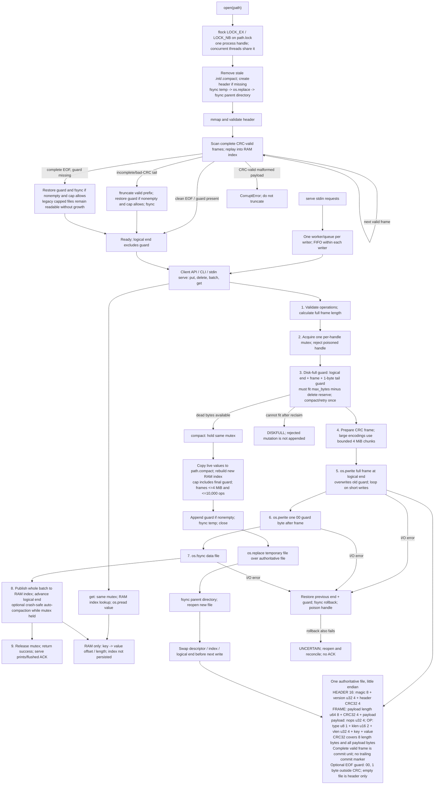

# Architecture

## Part 1: Current architecture diagram

The source is diagrams/architecture.mmd. Historical PNGs are not the current diagram. Integers are little endian. CRC32 is an integrity check, not authentication. A full valid frame is the commit unit; the EOF guard is expendable padding, not a commit marker. It is overwritten at the next append, so it costs one byte per nonempty file, not per operation.

## Part 2: Exact 32-scenario proof table

W, C and R refer to tests/test_crash_campaign.py: test_all_write_points_for_put_delete_batch_large_value_and_large_batch; test_all_compaction_points_with_multiple_frames; test_repeated_crashes_during_recovery. Seeds and fresh result counts are recorded in docs/GAP_FIX_REPORT.md. Named hooks exercise boundaries; OS rename atomicity is assumed. No claim covers all possible schedules.

| ID | PDF scenario | Disk state at interruption | Mechanism and code | Exact code location | Verification |
|---|---|---|---|---|---|
| A1 | Kill before put bytes | Prior complete frames plus their guard; new frame not written. | src/engine.py _write: before_write; W preserves prior state. | src/engine.py KVDB._write, _scan; src/format.py decode_frame | src/engine.py _write: before_write; W preserves prior state. |
| A2 | Torn put | Prior frames plus incomplete new frame, replacing the old guard. | _write torn_write; _scan discards incomplete frame; W and every-byte tail regression. | src/engine.py KVDB._write, _scan; src/format.py decode_frame | _write torn_write; _scan discards incomplete frame; W and every-byte tail regression. |
| A3 | Full put before fsync | Full new frame, possibly without guard; fsync has not returned. | _write after_write; complete CRC-valid frame may recover; W checks exact map. | src/engine.py KVDB._write, _scan; src/format.py decode_frame | _write after_write; complete CRC-valid frame may recover; W checks exact map. |
| A4 | After fsync before put return | Full frame and guard synced; RAM index may be stale. | _write after_fsync; frame is synced before index publication; W verifies value. | src/engine.py KVDB._write, _scan; src/format.py decode_frame | _write after_fsync; frame is synced before index publication; W verifies value. |
| A5 | Immediately after successful put | Full frame and guard synced before successful return and observed ACK. | A5_acknowledged_put: real serve ACK then SIGKILL; full map verified. | src/engine.py KVDB._commit; src/serve.py run/execute | ps_specific_scenarios A5_acknowledged_put |
| A6 | During delete | Old value plus no/partial/full delete frame; no partial key value. | _commit/_write; W delete at all five write points; deletion remains whole. | src/engine.py KVDB._write, _scan; src/format.py decode_frame | _commit/_write; W delete at all five write points; deletion remains whole. |
| A7 | During 1 MB value | Previous frames plus no/partial/full 1 MiB value frame. | W exact 1 MiB value and 500 large-values rounds; no partial value. | src/engine.py KVDB._write, _scan; src/format.py decode_frame | W exact 1 MiB value and 500 large-values rounds; no partial value. |
| B1 | First 3 of 10 operations written | Only the first three of ten operation bodies in an incomplete frame. | B1_exact_three_of_ten cuts real frame at operation-three boundary; SIGKILL; none visible. | src/engine.py KVDB._write; src/format.py decode_frame | ps_specific_scenarios B1_exact_three_of_ten |
| B2 | Ten ops written, commit marker absent | No separately appended marker state exists in this CRC-prefix format. | src/format.py decode_frame: CRC prefix + full payload forms the commit unit. There is no absent trailing marker after ten complete operations; this PDF state is not reachable. Incomplete frames expose none. Design equivalent; explain to judge. | src/format.py encode_frame, decode_frame | Design equivalent; exhaustive incomplete-frame cuts, W; no fabricated marker test |
| B3 | Marker written before fsync | One complete CRC-valid batch frame; fsync not yet returned. | Complete CRC-valid batch frame before fsync maps to _write after_write; W accepts whole frame, never subset. | src/engine.py KVDB._write, _scan | Complete CRC-valid batch frame before fsync maps to _write after_write; W accepts whole frame, never subset. |
| B4 | Successful ten-operation batch | All ten operations in one synced frame, followed by synced guard. | B4_acknowledged_ten_op_batch: ten ops ACK then SIGKILL; all survive. | src/engine.py KVDB._commit; src/serve.py run/execute | ps_specific_scenarios B4_acknowledged_ten_op_batch |
| B5 | Put X then delete X in batch | One complete frame containing put X then delete X, in list order. | B5_put_then_delete_after_crash; _commit applies list order; X absent after crash. README documents order. | src/engine.py KVDB._commit, _apply, _scan | ps_specific_scenarios B5_put_then_delete_after_crash |
| B6 | 10,000 ops torn halfway, recovery <2s | Exactly first 5,000 of 10,000 operation bodies in an incomplete frame. | half_batch.json: exact prefix through operation 5,000 of 10,000, real write and SIGKILL; no ACK, prior anchor only; strict timed recovery. Random-prefix B6 and W also pass. | src/engine.py KVDB._write, _recover | check_ps_half_batch: exact 5,000-op prefix, strict <2,000 ms |
| C1 | Kill replay scan | Original log unchanged; partially reconstructed RAM index lost. | _scan recovery_mid_scan; R and 500 recovery-crash rounds. | src/engine.py KVDB._scan | _scan recovery_mid_scan; R and 500 recovery-crash rounds. |
| C2 | Kill torn-tail repair | Torn tail still present, removed, or guard restoration incomplete. | _recover recovery_before_truncate/recovery_after_truncate; R and targeted mode. | src/engine.py KVDB._recover, _restore_tail_guard | _recover recovery_before_truncate/recovery_after_truncate; R and targeted mode. |
| C3 | Compaction before replacement | Old authoritative file plus partial/complete temporary file. | _copy_live/_compact_locked compact_mid_copy and compact_before_rename; C and compaction mode. | src/engine.py KVDB._copy_live, _compact_locked | _copy_live/_compact_locked compact_mid_copy and compact_before_rename; C and compaction mode. |
| C4 | Compaction rename/swap | Atomic replace names old or complete new file under the stated OS model. | _compact_locked os.replace boundary hooks; C and compaction mode. OS rename atomicity is assumed, not an injection inside kernel rename. | src/engine.py KVDB._compact_locked | _compact_locked os.replace boundary hooks; C and compaction mode. OS rename atomicity is assumed, not an injection inside kernel rename. |
| C5 | After swap before cleanup | Complete new file installed; temporary leftovers may exist. | _compact_locked compact_after_swap; C checks old data, leftover temp removal and later writes. | src/engine.py KVDB._compact_locked, _open_file | _compact_locked compact_after_swap; C checks old data, leftover temp removal and later writes. |
| C6 | During close | Committed frames and guard already synced before close starts. | close_mid; test_initial_creation_and_close_crashes and crashpoints mode. | src/engine.py KVDB.close | close_mid; test_initial_creation_and_close_crashes and crashpoints mode. |
| D1 | Two writers different keys killed randomly | Serialized complete frames from two writer threads; some calls pending. | runner.iteration independent sent/ACK histories; 500 default rounds plus 500 same-file F1 rounds. | src/engine.py KVDB._commit; src/serve.py run/worker | runner.iteration independent sent/ACK histories; 500 default rounds plus 500 same-file F1 rounds. |
| D2 | Two writers same key killed randomly | Serialized frames with conflicting key updates; replies can interleave. | Shared-key histories checked by torturelib/oracle.py match; shared batch regression detects impossible maps. | src/engine.py KVDB._commit, _apply | Shared-key histories checked by torturelib/oracle.py match; shared batch regression detects impossible maps. |
| D3 | Long batch racing single puts | Long batch and single-put calls overlap; one mutex protects append/index. | D3_long_batch_with_single_put: both entry markers observed; real engine, test-only delay and unchanged independent oracle; random kill. | src/engine.py KVDB.batch, put, _commit | ps_specific_scenarios D3_long_batch_with_single_put |
| D4 | Reader during same-key batch | Writer holds mutex while publishing the complete batch to RAM. | test_reader_cannot_observe_half_applied_batch and test_reader_sees_batch_all_or_nothing; get/_commit share lock. | src/engine.py KVDB.get, items, _commit | test_reader_cannot_observe_half_applied_batch and test_reader_sees_batch_all_or_nothing; get/_commit share lock. |
| E1 | Cap during put | Cap preflight rejects before append; optional compaction can reclaim space. | _check_space rejects before append; test_max_bytes and 500 disk-full rounds. | src/engine.py KVDB._check_space, _commit | _check_space rejects before append; test_max_bytes and 500 disk-full rounds. |
| E2 | Cap during batch | Full frame plus guard fails preflight; rejected batch is not appended. | _check_space reserves full frame; cap and memory-preflight tests, disk-full mode; rejected batch absent. | src/engine.py KVDB._check_space, _commit | _check_space reserves full frame; cap and memory-preflight tests, disk-full mode; rejected batch absent. |
| E3 | Cap then kill | Accepted frames and guard remain; rejected changes have no ACK. | disk-full mode close_mid SIGKILL; recovered full map compared against prior accepted writes. | src/engine.py KVDB._recover, _check_space | disk-full mode close_mid SIGKILL; recovered full map compared against prior accepted writes. |
| E4 | Cap during compaction | Old authority intact if copy fails; complete new file if replacement succeeds. | test_tiny_cap_during_compaction and failed-compaction preservation regressions; old/new complete state retained. | src/engine.py KVDB._write_compact_frame, _compact_locked | test_tiny_cap_during_compaction and failed-compaction preservation regressions; old/new complete state retained. |
| E5 | Delete, reclaim, write again | Dead records can be removed; successful later write includes its guard. | test_compact_and_retry_on_disk_full, cap campaign and million-delete shrink check. | src/engine.py KVDB._commit, _compact_locked | test_compact_and_retry_on_disk_full, cap campaign and million-delete shrink check. |
| F1 | 500 consecutive random kills/restarts | One database accumulates 500 independently checked random-kill histories. | ps_f1_same_database.py: all 500 use persistent.db, carrying the independently checked recovered state forward. Does not reset every three rounds. | src/engine.py KVDB._recover; torturelib/runner.py iteration | ps_f1_same_database: 500 rounds on persistent.db |
| F2 | Kill recovery repeatedly | Log/repair states are interrupted repeatedly; RAM state is disposable. | R and recovery-crash mode repeat three interrupted recovery attempts before final complete-map check. | src/engine.py KVDB._recover, _scan | R and recovery-crash mode repeat three interrupted recovery attempts before final complete-map check. |
| F3 | Million keys, kill, open <2s, ACKs preserved | At least one million accepted keys in complete frames; process killed. | Three fresh real-engine F3 seeds, strict recovery and complete CLI thresholds, all recovered values checked. | src/engine.py KVDB._scan; src/format.py decode_frame | ps_measure_recovery: three real-engine million-key SIGKILL benchmarks, strict <2,000 ms |
| F4 | Remove one trailing byte; lose at most unACKed | Removing one final byte removes the expendable guard, not frame payload. | src/engine.py _write syncs frame + guard before return; _recover replays the intact frame and restores a missing guard. Current-writer files reserve this byte inside the cap. | src/engine.py KVDB._write, _restore_tail_guard, _recover | test_tail_guard: put/delete/batch/compaction, repeated guard loss and interrupted restoration |

## Part 3: Three guarantees

**Durability.** Under the honest-fsync/process-kill model, _write loops on os.pwrite for the complete frame, writes the EOF guard, then calls os.fsync before _commit publishes the index and returns. serve prints ACK only afterward. Recovery replays the durable frame even if RAM publication or ACK transmission was interrupted. The expendable guard protects the literal one-byte-tail-loss case. A complete unsynced frame can also survive a process kill; that does not prove power-loss safety.

If append or sync fails, the engine attempts to restore the previous end and guard, syncs the rollback, poisons the handle and raises an error. If rollback cannot be confirmed, it raises UncertainWriteError and serve reports UNCERTAIN without an ACK. The engine does not automatically retry that failed append.

**Atomicity.** A batch is one length/CRC-checked frame. decode_frame validates the entire payload before replay. An incomplete frame is discarded as one unit, never partially applied. _commit and get/items use the same mutex, so a single read/snapshot cannot observe publication halfway through a batch. Operations inside a batch apply first to last: put X then delete X leaves X absent. Separate get calls are not a multi-key snapshot.

**Recoverability.** open takes flock, removes stale temporary files, validates the header and rebuilds the RAM index from complete frames. Torn tails are removed with os.ftruncate; guard restoration and os.fsync complete before readiness. Interrupted scan/repair can be repeated. Compaction syncs the temporary data plus guard, closes it, performs os.replace, fsyncs the parent directory and swaps the descriptor/index before another mutation. Before replacement the old file is authoritative; afterward the complete replacement is. CRC-valid malformed external content is rejected rather than silently erased.

**Compatibility and limits.** Legacy version-1 frames remain readable. Open adds a missing guard when the cap permits. A legacy file already at/over a newly configured cap is read without growing it; its old unguarded tail gains protection only after room is made and a current write/compaction succeeds. All successful current writes reserve and sync the guard. Older program versions may strip the guard. RAM input retention, very long logs, physical offline rehearsal and the pending original prompt log remain documented limitations; no power-cut claim is made.
