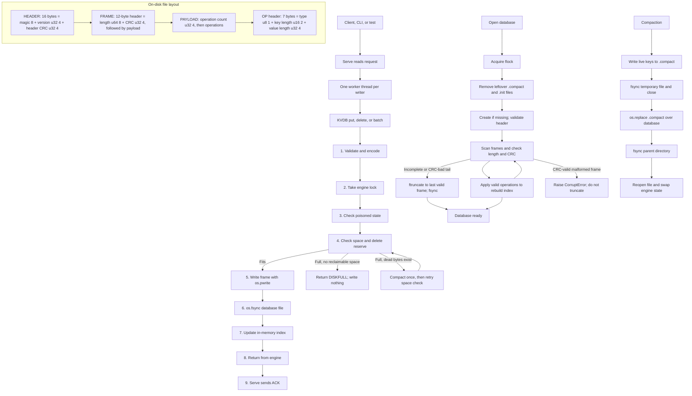

# Architecture

## Part 1 Diagram

## Part 2 Proof table
| ID | Scenario | What may be on disk | How the program should handle it | Code to check | Verified by |
|---|---|---|---|---|---|
| B1 | Crash during a 10-operation batch write | Earlier saved data and possibly part of the new batch | Recovery should discard an incomplete final frame | `_write()`; `_recover()`; `_scan()` | Not verified |
| B2 | Repeat the torn batch-write test | Earlier saved data and possibly part of the new batch | Reopening should recover earlier valid frames | `_write()`; `_recover()`; `_scan()` | Not verified |
| B5 | Batch deletes X, puts X, then deletes X | One complete batch frame | Operations happen in order, so X should be absent | `_commit()`; `_apply()`; `_scan()` | Not verified |
| C1 | Crash before compaction renames its new file | Old database and temporary `.compact` file | The old database should still be available | `_compact_locked()`; `_open_file()` | Not verified |
| C4 | Crash just after compaction replaces the database file | The compacted file is at the database path | Reopen the database and check its live keys | `_compact_locked()`; `_recover()` | Not verified |
| C5 | Check values after the compaction crash | Compacted database is at the database path | Reopened keys and values should match the expected live data | `_compact_locked()`; `_recover()` | Not verified |
| E1 | Fill the database until a put returns `DISKFULL` | Database has reached its configured size limit | The rejected value should not appear | `_check_space()`; `_commit()` | Not verified |
| E2 | Send a batch that does not fit | Existing database plus a batch that exceeds available space | None of the rejected batch’s changes should appear | `_check_space()`; `_commit()` | Not verified |
| E5 | Delete keys after `DISKFULL`, then try a put | Deleted records may leave space that compaction can reclaim | The later put should succeed if enough space is freed | `_commit()`; `_compact_locked()`; `_check_space()` | Not verified |

| ID | Scenario | Disk state | Mechanism | Where in code | Verified by |
|---|---|---|---|---|---|
| A1 | Crash before a write begins | Only previous frames are on disk | No new operation should appear | `_write()`; `before_write` | Not verified |
| A2 | Crash partway through a frame write | Previous frames plus an incomplete frame may be on disk | Recovery should discard the incomplete tail | `_write()`; `_recover()`; `_scan()` | Not verified |
| A3 | Crash after the complete frame write, before `fsync` | Complete frame may be in the file cache but not synced | No ACK has been sent; reopen checks whether the frame is complete and valid | `_write()`; `after_write`; `_recover()` | Not verified |
| A4 | Crash after successful `fsync`, before index update | Complete frame has been synced; in-memory index was not updated | Recovery rebuilds the index from saved frames | `_write()`; `after_fsync`; `_scan()` | Not verified |
| A5 | Crash after engine return, before server ACK | Complete frame has been synced; client may not know the result | Reopen should include the operation; client outcome is uncertain | `src/serve.py`; `after_return` (confirm hook) | Not verified |
| A6 | Write or `fsync` returns an error | A partial frame may have been written | Engine tries to truncate to old end, syncs rollback, and becomes poisoned | `_write()` | Not verified |
| A7 | Invalid operation fails validation | No new frame should be written | Validation rejects operation before append | `fmt.encode_frame()`; `_commit()` | Not verified |
| B1 | Crash during a 10-operation batch write | Previous frames and possibly part of batch are on disk | Incomplete batch frame should be discarded as a whole | `_write()`; `_recover()`; `_scan()` | Not verified |
| B2 | Repeat torn batch write at another write point | Previous frames and possibly part of batch are on disk | Reopen should retain earlier valid frames and reject incomplete tail | `_write()`; `_recover()`; `_scan()` | Not verified |
| B3 | Batch contains an invalid operation | No batch frame should be written | Validate/encode rejects batch before append | `fmt.encode_frame()`; `_commit()` | Not verified |
| B4 | Batch exceeds the operation limit | No batch frame should be written | Validation rejects batch above 10,000 operations | `fmt.encode_frame()` | Not verified |
| B5 | Batch deletes X, puts X, then deletes X | A complete batch frame is on disk | Operations apply first to last, so X ends absent | `_commit()`; `_apply()`; `_scan()` | Not verified |
| B6 | Batch contains several valid operations | One complete frame contains all operations | Recovery applies all operations from that valid frame in order | `fmt.encode_frame()`; `_scan()`; `_apply()` | Not verified |
| C1 | Crash at `compact_before_rename` | Old database plus complete synced `.compact` file | Old database remains at the database path; leftover temp is removed on next open | `_compact_locked()`; `_open_file()` | Not verified |
| C2 | Crash during `compact_mid_copy` | Old database plus partial `.compact` file | Old database remains usable; next open removes temp file | `_copy_live()`; `_open_file()` | Not verified |
| C3 | Complete a normal compaction | New compacted file contains live keys only | Synced temp file replaces old file; engine swaps to new file/index | `_compact_locked()`; `_copy_live()` | Not verified |
| C4 | Crash at `compact_after_rename` | Compacted file is at database path; directory sync has not run yet | Reopen checks the file at the database path; power-loss durability is not proven by process-kill test | `_compact_locked()`; `_fsync_dir()` | Not verified |
| C5 | Check live values after `compact_after_rename` | Database path points to compacted file | Reopen and compare all live keys/values with expected state | `_compact_locked()`; `_recover()` | Not verified |
| C6 | Crash at `compact_after_swap` | Compacted file was renamed and directory-synced; engine swapped file/index | Reopen should recover compacted data | `_compact_locked()`; `_recover()` | Not verified |
| D1 | Open database with incomplete final frame | Valid frames followed by incomplete tail | Recovery truncates at last valid frame and syncs file | `_recover()`; `_scan()` | Not verified |
| D2 | Open database with CRC-mismatched final frame | Valid frames followed by frame with bad CRC | Recovery treats final damaged tail according to format decoder and truncates it | `_recover()`; `fmt.decode_frame()` | Not verified |
| D3 | Open database with CRC-valid malformed frame | Frame bytes and CRC are present, but operation data is invalid | Report corruption; do not silently truncate as a torn tail | `_scan()`; `fmt.decode_frame()` | Not verified |
| D4 | Crash during recovery truncation | File may still contain torn tail, or truncation may have completed | Reopen repeats recovery; after truncation it syncs valid end | `_recover()`; `recovery_before_truncate`; `recovery_after_truncate` | Not verified |
| E1 | Fill limited database until a put returns `DISKFULL` | Database has reached configured limit | Rejected put should not be appended or visible | `_check_space()`; `_commit()` | Not verified |
| E2 | Send a batch that does not fit | Existing database plus oversized batch | None of the rejected batch changes should be visible | `_check_space()`; `_commit()` | Not verified |
| E3 | Use reserved space for a delete | File is near limit but delete reserve remains | Delete-only write may use reserved bytes | `_check_space()` | Not verified |
| E4 | `DISKFULL` occurs while dead bytes exist | File contains obsolete records that can be reclaimed | Engine compacts and retries the write once | `_commit()`; `_compact_locked()`; `_check_space()` | Not verified |
| E5 | After `DISKFULL`, delete keys and try a put again | Deleted records leave reclaimable dead bytes | Later put should succeed if compaction frees enough room | `_commit()`; `_compact_locked()`; `_check_space()` | Not verified |
| F1 | Open same database a second time | First process holds `<path>.lock` | Second open should fail with `LockedError` | `_flock()` | Not verified |
| F2 | Two operations from the same writer arrive in order | Both operations are submitted to same writer queue | Server should process that writer’s commands in input order | `src/serve.py` worker/queue (confirm) | Not verified |
| F3 | Two writer threads write concurrently | Multiple complete frames may be appended | Engine lock serializes writes so frames do not overlap | `_commit()`; `self._lock` | Not verified |
| F4 | Read while a write or compaction is in progress | File/index update is protected by engine lock | Reader waits for lock and sees a consistent index/file state | `get()`; `items()`; `_commit()`; `compact()` | Not verified |

## Part 3 Durability / Atomicity / Recoverability

### Durability
The write path calls `os.pwrite` through `_pwrite_all()` until the frame is written, then calls `os.fsync(fd)`. The engine updates the index and returns only after the sync succeeds. The server sends ACK after the engine call returns.

If a write or `fsync` fails, the engine truncates the file back to the previous end, calls `fsync` for the rollback, marks the database poisoned, and raises an error. If rollback also fails, the engine returns `UncertainWriteError` and the server reports `ERR <id> UNCERTAIN`. The failed write is never retried.

### Atomicity
One batch is encoded as one frame with one CRC32 covering its length and payload. Recovery applies the frame only when all bytes are present and the CRC matches. A CRC-valid but malformed frame raises `CorruptError` and is not truncated. Operations inside a valid batch apply first to last.

Readers take the same `threading.Lock` used by writes. A reader therefore sees the batch fully applied or not applied; it does not see half of a batch.

### Recoverability
Opening the database takes `flock`, removes leftover `.compact` and `.init` files, and scans the database with `mmap`. New files are created through `.init`, followed by file `fsync`, `os.replace`, and parent-directory `fsync`. Recovery truncates a torn tail with `ftruncate` and `fsync`.

Compaction writes live keys to `.compact`, calls `fsync`, replaces the database with `os.replace`, syncs the parent directory, then reopens the file and swaps the engine state. Recovery only scans, removes temporary files, and truncates a torn tail, so repeating recovery after a process kill is safe.

Process-kill behavior was tested; power-cut behavior is argued from the ordering but was not tested.
