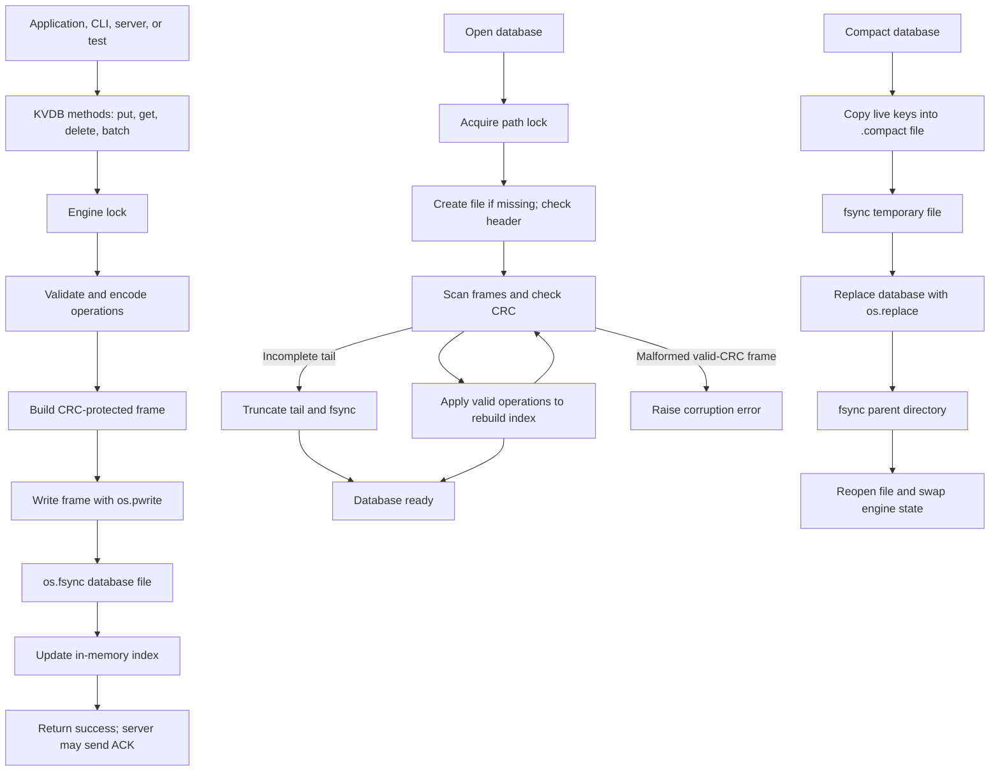

# Architecture

## Part 1 Diagram

## Part 2 Proof table
| B1 | Crash during a 10-operation batch write | Previous frames plus a partial final frame may be on disk | Recovery should ignore/truncate the incomplete final frame; the batch must not be partly applied | `_write()`; `_scan()`; `fmt.decode_frame()` | Not verified |
| B2 | Repeat the torn batch-write test | Previous frames plus a partial final frame may be on disk | Reopening should recover valid earlier frames and handle the incomplete tail | `_write()`; `_recover()`; `_scan()` | Not verified |
| B5 | Batch deletes X, puts X, then deletes X | A complete batch frame is on disk | Operations apply first to last, so X should be absent | `_commit()`; `_apply()`; `_scan()` | Not verified |
| C1 | Crash at `compact_before_rename` | Old database plus a complete, synced `.compact` file | The old database should remain the database used on reopen | `_compact_locked()`; `os.replace()` | Not verified |
| C4 | Crash at `compact_after_rename` | The database path refers to the compacted file; directory sync has not yet happened | Reopen and check that the database is valid and contains the live keys | `_compact_locked()`; `_fsync_dir()` | Not verified |
| C5 | Repeat the `compact_after_rename` test | The database path refers to the compacted file | Reopen and compare the live keys and values with the expected data | `_compact_locked()`; `_recover()` | Not verified |
| E1 | Fill a limited-size database until a put returns `DISKFULL` | Database has reached its configured space limit | The rejected put should not be visible | `_check_space()`; `_commit()` | Not verified |
| E2 | Send a batch that does not fit | Existing database file; batch should not be appended | None of the rejected batch’s changes should be visible | `_check_space()`; `_commit()` | Not verified |
| E5 | After `DISKFULL`, delete some keys and put again | Deleted data leaves reclaimable space | A later put should succeed if space is available after compaction or deletion | `_commit()`; `_compact_locked()`; `_check_space()` | Not verified |
| ID | Scenario | Disk state | Mechanism | Where in code | Verified by |
|----|----------|------------|-----------|---------------|-------------|
| A1 | | | | | |
| A2 | | | | | |
| A3 | | | | | |
| A4 | | | | | |
| A5 | | | | | |
| A6 | | | | | |
| A7 | | | | | |
| B1 | | | | | |
| B2 | | | | | |
| B3 | | | | | |
| B4 | | | | | |
| B5 | | | | | |
| B6 | | | | | |
| C1 | | | | | |
| C2 | | | | | |
| C3 | | | | | |
| C4 | | | | | |
| C5 | | | | | |
| C6 | | | | | |
| D1 | | | | | |
| D2 | | | | | |
| D3 | | | | | |
| D4 | | | | | |
| E1 | | | | | |
| E2 | | | | | |
| E3 | | | | | |
| E4 | | | | | |
| E5 | | | | | |
| F1 | | | | | |
| F2 | | | | | |
| F3 | | | | | |
| F4 | | | | | |

## Part 3 Durability / Atomicity / Recoverability

### Durability
A successful write is not reported immediately. The engine first writes the encoded frame to the database file using `_pwrite_all()`, which calls `os.pwrite()` until all frame bytes have been written. It then calls `os.fsync()` on the database file. Only after `_write()` returns does `_commit()` update the in-memory index and finish the operation. The server can send an ACK after the engine call returns.

This ordering means that if the process crashes after `fsync()` but before updating the in-memory index, reopening the database can rebuild the index by scanning the saved frames. If a write or sync raises `OSError`, `_write()` tries to truncate the file back to the previous end, syncs that rollback, marks the engine poisoned, and raises the error.

### Atomicity
A batch is encoded into one frame. The frame is treated as the commit unit: recovery should apply the batch only if the complete frame passes the format checks. Operations inside a valid batch are applied in order, from first to last. For example, deleting X, putting X, and then deleting X should leave X absent.

An incomplete frame or a frame with a CRC mismatch at the end is handled as a torn tail during recovery. A CRC-valid frame with malformed contents is reported as corruption rather than silently treated as a torn write. Confirm these cases against `src/format.py`.

### Recoverability
When opening the database, the engine takes an exclusive lock, removes leftover `.compact` and `.init` files, checks the database header, and scans frames to rebuild the index. If it finds a torn tail, it truncates the file to the last valid frame and calls `fsync()`.

During compaction, the engine writes live keys to a `.compact` file, syncs and closes that file, replaces the database using `os.replace()`, and syncs the parent directory. It then reopens the database and swaps in the new file and index.

These steps are intended to leave a recoverable database if the process stops during recovery or compaction. The crash tests should confirm the behavior at each crash point. The code shown does not by itself prove behavior during a real power failure or on filesystems that have not been tested.
